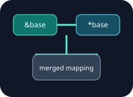

## 🧭 Overview

A safe local Python CLI that inventories YAML anchors, aliases, and merge keys, then shows the resolved data produced by PyYAML's safe loader.

## ✨ Features

- ⚓ List anchor declarations and alias references with line numbers.
- 🔀 Detect merge-key locations and show the resolved mapping.
- 🛡️ Parse with safe_load; never construct arbitrary Python objects.
- 📦 Print JSON for automation or review.

## 🎬 Demo

No hosted demo is provided. Run the local example with the command below.

## ⚡ Quick Start

~~~bash
python yaml_anchor_lab.py examples/anchors.yaml
~~~

## 🧰 Tech Stack

- Python 3.10+ · PyYAML
- Local-first execution; no external API calls

## 🗂️ Folder Structure

~~~text
yaml-anchor-playground/
├── yaml_anchor_lab.py
├── requirements.txt
├── examples/anchors.yaml
├── test_yaml_anchor_lab.py
├── assets/mark.svg
├── .gitignore
├── LICENSE
└── README.md
~~~

## 🗺️ Roadmap

- [x] Core behavior and local examples
- [x] Custom SVG and setup documentation
- [ ] Add more guided exercises from community feedback

## 🤝 Contributing

Issues and focused pull requests are welcome. Keep examples reproducible and within the documented scope.

## 📄 License

MIT License. See [LICENSE](LICENSE).

